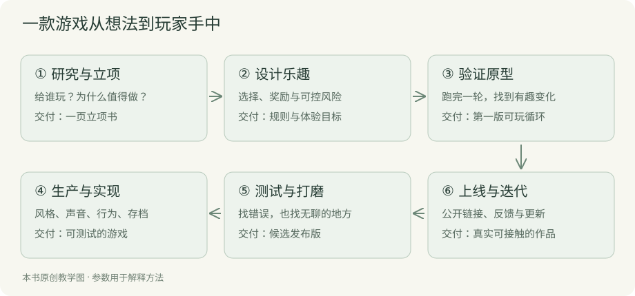

# 前言 先让一家小店开门

你想做一款餐厅经营游戏。店面不用很大，几张桌子，一个厨房，顾客会进来点餐。赚到钱以后，可以添炉灶、换菜单，慢慢把生意做起来。

这个想法不难说清楚。难的是下一步：从哪儿开始？让 AI 写什么？生成的代码打不开怎么办？厨房、顾客和收款怎样连在一起？好不容易在自己电脑上玩起来，又该怎样发给别人？

这本书按做游戏的顺序回答这些问题。先想清楚玩家来这里玩什么，再做出能营业一天的小店，然后补画面、声音、存档和升级，最后发布给玩家。每到一个地方，我们都拿同一家餐厅来讲，不用重新熟悉另一套例子。

## 先玩一轮，后面的内容会容易很多

打开[餐厅案例](../examples/restaurant/index.html?stage=1)。点击三次简餐旁的采购按钮，库存会增加到十五份，现金从一千变成八百八十。然后开门。

你会看到顾客进店、厨房做餐、现金增加。有人吃完离开，也可能有人没等到餐就走了。营业结束后，看看今天赚了多少，哪些顾客没接待上。如果再开一天，你准备多买食材，还是先想办法加快出餐？

这个问题就是后面要讨论的经营玩法。你不用先懂“核心循环”或“资源系统”，记住刚才发生的事情就够了。遇到术语时，书里会把它对应到这些具体动作。

## 不会画画、不会编程，也有起点

前几章会带你选做法，不要求你凭空想出一套设计。画面可以先沿用书里的奶油色背景、木色家具和深绿按钮；代码由 AI 编写。你可以先让它改一个价格，再让它改一个制作时间，玩过以后决定要不要保留。

做这些练习时，AI 负责建项目、写代码、制作素材和修错。你要学的是把想法说清楚，并且判断改完以后对不对。比如采购五份食材花四十元，手上只有三十九元时，程序应该拒绝。这件事不用会编程也能检查。

需要知道一项功能怎么实现时，可以请 AI 用一次实际操作解释。正文会把要求怎么说、结果怎么看讲清楚，不要求你手动找函数或拼代码。

## 这家餐厅做到了哪里

配套案例有三个入口：[只经营简餐](../examples/restaurant/index.html?stage=1)、[加入菜单和客流变化](../examples/restaurant/index.html?stage=2)、[经营七天的版本](../examples/restaurant/index.html?stage=3)。你可以在线玩，也可以[下载文件](https://linghugoogle.github.io/ai-coding-simulation-games/downloads/restaurant.zip)，让 AI 帮你改成自己的版本。

它包含采购、订单、制作、座位、升级、结算、保存，以及少量声音和图标。桌椅位置固定，做餐和送餐也作了简化，让第一版容易玩懂。自由装修、员工走路和背景音乐，会在相关章节说明怎样请 AI 添加。

所有价格和时间都是为讲解设置的，不能拿去估算真实餐厅的生意。这份案例也没有经过足够多玩家的长期试玩。你跟着书改出自己的版本以后，仍然需要请人来玩，看看它到底有没有意思。

## 怎样读这本书

如果你准备边读边做，就从第一章往下走。每章最后留一件小事：告诉 AI 你想做什么，让它改一个地方再试玩，或者请朋友试一次。做完以后再继续，前后的内容就能接起来。

如果你已经开了项目，可以从自己卡住的地方读。不过，最好也看看第二章。代码能运行、美术够漂亮，和玩家愿意继续玩，是几件不同的事。做得越早，越值得问一句：玩家今天做的决定，会让明天有什么不同？
