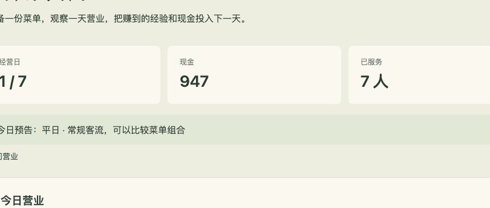

# 第二章 怎样让玩家想再开一天店

顾客进店，厨房做餐，交餐后收钱，这条过程很容易想明白。但如果玩家每天只是按同样的数量采购，然后等钱涨起来，玩几次以后大概就不想再开了。

我们要给他一些值得改变的事情。今天套餐赚得多，却做得慢；明天有活动，可能来更多人，要不要提前买炉灶？新炉灶买完，手里的钱又不够多备食材。玩家需要作判断，也能看到判断留下的结果。

这一章从菜单讲到奖励和成长，把这些关系放进同一家小店里。

## 先决定一天怎么玩

街角餐厅的一天分成三个部分。

营业前，玩家看预告，选菜单、买食材，决定要不要添设备。营业中，顾客陆续来，厨房按订单制作，玩家可以观察、暂停和加速。打烊后，游戏给出今天的账和没接待上的人数，玩家再安排明天。

这种前后相接的安排，常被叫作“核心循环”。你可以把它理解成玩家会一遍遍经历的过程：准备，营业，看结果，再准备。写设计时，不必从术语起步，把这一天讲顺就好。

一次订单也有小过程：有人下单，等餐，吃完离开。几天以后又有较大的目标：攒钱买第二个工位。小过程让人不断看到事情发生，日结让人比较做法，几天后的目标则给了省钱的理由。

## 三道菜，已经能做出取舍

先给餐厅放三道菜：

| 菜品 | 售价 | 食材成本 | 制作时间 |
| --- | --- | --- | --- |
| 简餐 | 20 | 8 | 10 秒 |
| 盖饭 | 30 | 12 | 18 秒 |
| 招牌套餐 | 45 | 20 | 30 秒 |

一份套餐扣掉食材能留下二十五元，比简餐的十二元多。只看这一项，玩家可能会觉得应该一直卖套餐。

可厨房只有一个工位。同样三十秒，理论上能做三份简餐，留下三十六元；套餐只能做一份，留下二十五元。这里还没算顾客等得住多久，也没算是不是真的有三份简餐订单。单份赚得多，不一定让整天赚得多。

这个差别就够玩家试一试了。他可以走快餐路线，接更多单；也可以卖慢一些、单价更高的菜，再用设备提高出餐能力。为了让两种安排都有机会，后续还要看客流、价格和座位。若所有顾客无条件买简餐，简餐仍可能成为固定答案。

设计菜品时，用同一张表横着比较。若新菜价格更高、成本更低、做得还更快，玩家很快就只会卖它。你可以给它一个明确代价，例如原料贵、耗时长，或者只有某些顾客喜欢。

## 贵一点，会不会更赚钱

餐厅允许三个价格档位：亲民、原价和精品。抬高价格能多赚一单，但也会有人看价后离开。这样，定价才需要判断。

先用几个看得懂的档位就够。玩家选档位时显示实际售价；一天结束时，告诉他有多少人因为价格放弃。如果只让价格上涨，却看不到顾客减少，玩家不知道发生了什么；如果涨价完全没有代价，降价又没有理由。

配套案例用一个简单概率表示顾客是否接受价格。它能演示这种关系，却不代表现实中的餐饮需求。等玩法跑通后，你可以再加不同顾客：有的赶时间，有的愿意多花钱吃套餐。那时菜单和定价会有更多可考虑的事。

## 钱多了，为什么还会感觉没赚钱

先把账算清楚。假设今天完成十份简餐、八份盖饭和四份套餐：

```text
收入：10×20 + 8×30 + 4×45 = 620
这些餐用掉的食材：10×8 + 8×12 + 4×20 = 256
每天固定费用：120
今天的利润：620 - 256 - 120 = 244
```

固定费用先把房租、基础工资和水电合在一起。这样新手只需记一个数字。如果以后要让排班成为玩法，再把工资拆出来，并从这一百二十元中去掉对应部分。

再看手头现金。假设开门前有一千元，采购花三百二十元。今天收了六百二十元，再付固定费用，打烊时现金是一千一百八十元。现金只多了一百八十元，为什么利润却是二百四十四元？

剩下的六十四元还在食材里。食材买回来了，但没全部卖掉，它们留在库存中。游戏的日报如果把采购支出和已用食材混为一谈，玩家会看得一头雾水。

界面可以把它们分开写：“今天付了多少采购款”和“卖出的餐用了多少食材”。若食材会坏，再另列损耗。已经采购时扣过现金的食材，报废时只减少库存、记录损失，别再扣同一笔钱。

这一组数字可以让 AI 用配套的 `examples/economy.mjs` 帮你复算。它只算账，没算排队，因此不能用它推断今天一定能卖出这些餐。



这张图不是上面算例的结果，而是三道菜都上架、采用精品价的一轮实机记录。它把利润与现金变化分开，也记下了九位顾客因价格放弃、四位顾客等餐超时。数字本身不用背下来；你要看的是，玩家能不能从这些结果找到明天想改的事情。

## 看看究竟卡在哪里

晚上有钱了，玩家准备加两张桌子。加完以后，餐厅坐满了，收入却没增加多少。因为厨房依旧一次只能做一份，更多人坐着等，最后等不及离开。

这就是常说的“瓶颈”：整家店里最拖慢生意的地方。眼前可能缺座位，也可能缺出餐能力。看起来都很忙，不代表买什么都有效。


要让玩家判断，就把等待发生的位置画出来。门口进不来，是座位不够；坐下后一直等，是厨房跟不上。日报分别列出人数。玩家才有机会想：“昨天我买错了，应该先添炉灶。”

刚开始只做一两种明显的问题。把缺货、清洁、员工心情、设备故障全放在第一天，新玩家往往分不出哪个才是原因。等他学会看订单和库存，再增加新的麻烦。

## 玩家作了决定，游戏得让他看见用处

有些变化很小，却很重要。比如换了快菜，等餐条明显短了；买了第二工位，厨房能同时做两份；少采购一点，打烊后浪费少了。

这些画面能让玩家把结果和自己的安排联系起来。若所有变化都藏在一个总收入里，他可能只觉得“这回运气不错”。可以同时显示服务人数、缺货、等餐超时和剩余库存，帮助他比较。

日报也不必替玩家下结论。同一天可能既涨价又换菜单，游戏未必知道收入变化到底因为什么。把事实给清楚，让人自己判断，比一条不准确的“策略成功”更有帮助。


图里最值得检查的是后半段：今天结束以后，玩家有没有想做的下一件事？他可能想试另一道菜，也可能还差几十元就能买设备。下一步越具体，重新开门就越自然。

## 奖励可以有几种，分别用在不同地方

第一份餐做完，顾客吃到了，钱到账了，响一声轻短的提示。这件事本身就带来一个小收获：店真的开起来了。

一天结束，玩家看到利润，知道又离第二个工位近了一点。这是较长一点的收获。几天后设备买下来，厨房的做法变了，之前的储蓄就有了用处。

还有一些收获不必送钱。可以记住第一位顾客、第一次盈利、第一次单日服务十二人。配套案例用了这三项纪念，帮助玩家回看自己做到了什么。它们不额外往经济里塞钱，经营收入仍然来自卖餐。


如果准备发一笔额外奖励，先看它会怎样影响后续。一笔太大的新手奖金，可能让玩家跳过第一次攒钱，也让设备购买失去期待。金额小一点，或者改成一个装饰、一个新选项，效果会不同。

奖励出现时也要节制。每单都弹大窗口，玩家很快会想关掉它。普通收款用轻提示，真正重要的第一次再停留一下。让人有机会高兴，也让他能继续看店。

## 不确定性从哪里来

如果每天的顾客数量、点单和到店时间都一样，玩家可能试出一套做法以后就不再想了。但每天随机扣一半钱，也只会让人觉得自己的努力没用。

可以让玩家提前知道一部分，剩下一部分到现场才发生。比如预告明天有街区活动，可能来更多人。玩家因此考虑多备食材、选快菜或买工位。但每个人几点到、点什么，仍然有变化。

配套案例给出雨天、平日和街区活动三种预告。它们影响到店概率。雨天备得太多，可能剩食材；活动日备得太少，可能错过生意。无论结果如何，玩家都有可以提前做的事。


一次先加一种变化。只有客流不同，已经能看出菜单和采购的作用。随后若想加原料涨价，可以提前一天通知，并给玩家换菜单的机会。若想加设备故障，考虑能不能维修、临时改做别的菜，以及会不会把一整天直接毁掉。

## 多买一点，是机会也是风险

把采购量交给玩家以后，他自然会担心两件事：买少了不够卖，买多了留到明天会不会坏。

案例每天让剩余食材损耗百分之二十，份数向下取整。剩五份坏一份，剩四份则不坏。这个简单做法容易解释，也有小份库存几乎不损耗的问题。后续想做保质期，可以让不同批次分别记录，但那会让代码和界面都更复杂。

先用简单规则看玩家是否会改变采购。若损耗少得没人关心，它没有形成风险；若损耗多到怎么采购都亏，就要降低。不要只给食材加一个“新鲜度”数字，却让玩家无法据此安排。

## 升级要让以后的玩法有变化

街角餐厅有三种设备投资：加座位、加一个工位、缩短制作时间。它们解决的问题不同，因此玩家需要先看店里缺什么。

第二工位花三百元。玩家如果刚好有三百，买完后食材钱在哪里？这就有了存钱和买设备的时机。若升级只要有钱就能无脑买，又不影响采购，投资这件事很快会变成固定点击。

有了更多设备以后，也要减少旧的重复劳动。玩家已经懂得怎样采购，可以给他更方便的数量输入或采购预设。省下来的精力可以用来比较新菜单。若自动化后完全没事可做，则要看游戏究竟想提供轻松观看，还是继续经营判断，再安排相应内容。

## 怎样安排玩家的第一天

第一天只需要让玩家明白三件事：食材先花钱买，餐做完才收钱，打烊要付费用。简餐一种就够。采购建议直接显示在开场，让他先完成一天。

第二步再介绍菜单。让他发现“套餐一单赚得多，但厨房做得慢”。等他遇到一次排队，再开放第二工位。这样设备是在解决他已经看见的问题，购买才有盼头。

七天可以这样安排：

| 时候 | 给玩家一件新事情 | 希望他想明白什么 |
| --- | --- | --- |
| 初次营业 | 采购简餐并看日报 | 钱从哪里来，又花在哪里 |
| 熟悉以后 | 两三道菜和价格档位 | 做得快、赚得多、卖得出并非一回事 |
| 第三天前后 | 第二工位 | 存钱可以买来不同的生产能力 |
| 接下来几天 | 客流变化与设备选择 | 根据预告和流失原因调整 |
| 第七天结束 | 回看经营记录 | 哪次改变有效，重来想试什么 |

这张表是做教程时的安排。当前三个案例入口把学习内容分开，第三个入口则直接提供较完整的规则。读者可以分开体验，也可以自己实现逐天开放的版本。

## 让 AI 提方案，把顾客的一天讲清楚

你可以先说“顾客等太久会走”，再让 AI 帮你补全做法。等多久？制作中也算吗？走了以后食材退不退？工位会不会空出来？这些答案会直接影响经营。

当前案例是从等餐开始累计四十五秒；制作也占这段时间；超时取消，已经投入的食材算损耗；工位可以接下一单。暂停时不计时。

你可以选择别的规则，例如做好以后仍能卖给下一位顾客，但要告诉 AI，也要让界面说得清楚。让 AI 把一位顾客从进店到离开讲一遍，看看有没有你没想到的地方。用具体的一单讲明白，比一句“完善订单系统”管用。

## 自己试三种安排

先只卖简餐，采购十五份，记录结果。然后改成包含套餐的菜单，再试一次。最后，在有第二工位的日子比较快菜和慢菜。

看收入，也看服务人数、等待和剩余。若每次结果不同，先检查有没有改动客流或菜单；想准确比较，可以固定订单顺序。固定种子能帮助重现一局，但修改随机调用的代码以后，同一号码也不保证对应同一批订单。

做完不必急着宣布哪种设计最好。更有用的是说清楚：“这个情况下，厨房跟不上，所以我试了快菜；那种情况下，座位更紧张，我需要看顾客停留多久。”能够这样解释，你就开始用规则设计经营了。

## 没想好玩法，也可以从两个方案里选

如果还不知道应该怎样经营，可以直接告诉 AI 你想要的感觉。例如：“我想做一家轻松的小店，玩家不需要一直忙着点，但也别开门以后只能干等。给我两种玩法，用一轮营业说明区别。”

让它具体到操作。一个方案可能是营业前选菜单、营业中观察；另一个可能增加偶尔出现的大订单。再问每种做法需要玩家注意什么，错过会怎样。你可以按自己更想玩的那一种选择。

选择以后，先做短版试玩。若玩起来不如描述有趣，把具体感受说出来：“我选完菜单以后就没有事情了”“大订单来的太频繁”“我不知道升级有没有用”。让 AI 根据这件事改一处，再比较。

你不必独自准备一整本设计文档。可以让 AI 记录已经确认的规则，遇到尚未决定的地方给少量建议。方向和喜欢什么由你判断，专业方案与实现由它帮你补齐。
