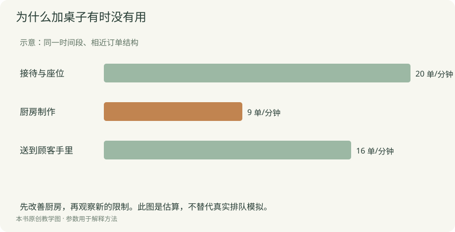
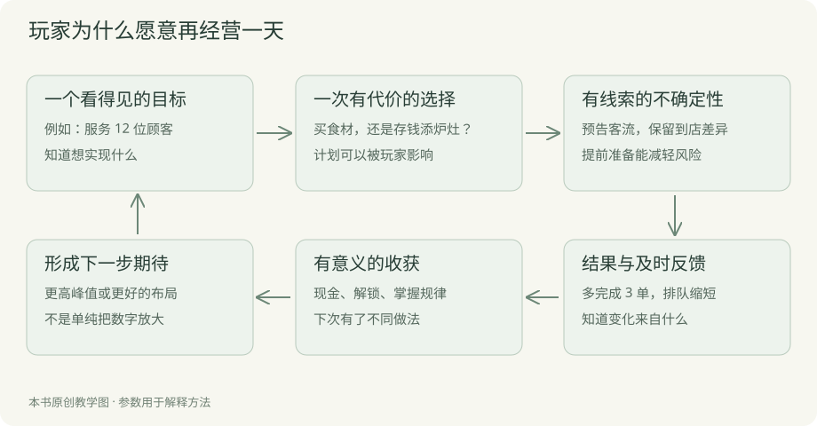
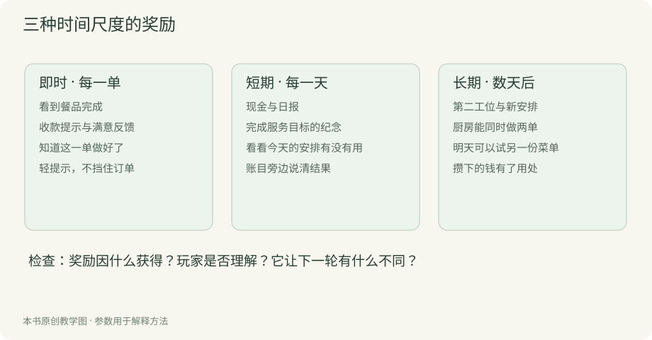
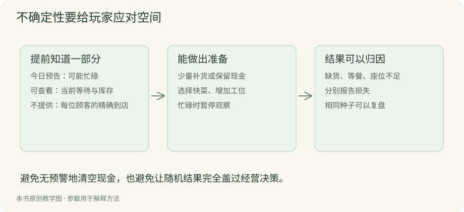

# 第二章 游戏玩法设计

玩法设计要把立项中的体验变成规则。玩家点击采购之后改变什么，厨房忙碌时订单去哪里，升级为什么值得攒钱，这些问题共同决定经营过程。规则需要具体到可以实现，但每个规则也应该解释它服务的体验。

## 确定模拟的边界

真实餐厅涉及租约、消防、食材保存、清洁、人员关系和大量偶发情况。游戏应选择对目标体验有帮助的部分，并压缩其余内容。案例先让厨房、座位、订单和库存影响经营，把水电和基础工资合并为每天固定费用。这样玩家更容易看懂主要因果。

合并会损失细节，也节省理解成本。若以后要让排班成为核心决策，就把工资和员工从固定费用中拆出来；不能一边收固定费用，一边重复扣工资。每次增加精度都应回答：玩家因此多了什么可理解、可影响的选择？

## 把循环画成资源变化

案例的日循环是：准备菜单与采购，开始营业，顾客下单，厨房生产，完成服务并收款，打烊结算，调整下一天计划。循环中现金买来食材，食材与时间换成餐品，完成的服务产生收入，收入支持下一轮采购和升级。

除了主循环，还要明确两个时间尺度。订单是短循环，让玩家观察效率；每天是中循环，让玩家比较方案；数日后的设备投资是长循环，让当前节省有意义。原型阶段先贯通前两个，确认经营结果足以引发下一次调整。

为每个动作写下输入、条件、输出与失败原因。采购消耗现金并增加库存；制作在开工时预留食材，完成时生成餐品；结算只处理已经履约的订单。没有条件说明的动作，会把设计缺口推迟到代码中。

## 用相互影响的选择形成经营

菜单提供最容易理解的起点。设定三道教学菜品：

| 菜品 | 售价 | 单份食材成本 | 占用厨房时间 |
| --- | --- | --- | --- |
| 简餐 | 20 | 8 | 10 秒 |
| 盖饭 | 30 | 12 | 18 秒 |
| 招牌套餐 | 45 | 20 | 30 秒 |

三者的单份贡献分别为 12、18、25；每厨房秒的贡献约为 1.20、1.00、0.83。套餐的单份贡献最高，单位厨房时间贡献较低。当厨房是瓶颈时，菜单结构的效果会与按单份利润排名不同。

这不意味着简餐永远最优。顾客偏好、价格接受度与需求数量限制它的销量；若有闲置厨房而座位周转很慢，其他因素又会成为瓶颈。先建立清楚的简化模型，再逐步加入需求与服务过程，不要用复杂公式遮住基本关系。

定价也需要实际后果。提高价格可以增加每单收入，但部分客群下单意愿降低。第一版可用几个清楚的价格档位，并在日报说明拒购数量。不要先加入连续弹性公式，却不给玩家观察与比较的机会。

## 数值先保证账能对上

假设一天卖出 10 份简餐、8 份盖饭、4 份套餐，全部完成服务并收款：

```text
收入 = 10×20 + 8×30 + 4×45 = 620
已售食材成本 = 10×8 + 8×12 + 4×20 = 256
固定费用 = 120
营业利润 = 620 - 256 - 120 = 244
```

若当天采购支出为 320，且没有其他现金收支：

```text
期末现金 = 1000 - 320 + 620 - 120 = 1180
剩余库存价值 = 320 - 256 = 64
```

利润 244 与现金净增加 180 的差额，是留在库存里的 64。教学模型不处理税费、赊账和折旧，因此这些结果只在当前假设下成立。配套经济示例可以复算这组数据。

如果食材会腐坏，还需把报废成本计入利润，同时减少库存。采购时已经付过钱，报废时不能再扣同一笔现金。设备投资同样要区分现金支出与资产；为了降低入门负担，可以先把报告称为“现金收支表”，再加入更完整的利润表达。

## 把瓶颈变成可见的问题



厨房一天能处理多少订单，取决于可用时间、并行工位和菜单组合；餐厅能接待多少人，还受座位、用餐时间与服务能力限制。仅用“销量等于几个上限的最小值”适合粗略估算，不能准确表达随机到店和排队。

实现中应观察队列：顾客等待在哪个阶段，等待多久，为什么离开。增添座位可能让更多顾客坐下，却没有缩短厨房队列。日报如果只写收入下降，玩家难以判断；若显示“厨房等待导致 6 单取消”，调整才有方向。

一次只让一个或两个主要瓶颈突出。所有资源同时紧缺会让新玩家无法归因，所有上限同时解除又缺少变化。通过逐步开放设备和客群，让玩家在熟悉旧关系后遇到新的约束。

## 成长要改变安排方式

设计三种升级：提高现有工位效率、增加并行工位、解锁不同加工方式。它们分别改变等待时间、同时处理数量与菜单组合。玩家需要比较当下瓶颈，而不是每次购买同一个百分比提升。

自动化释放重复操作之后，需要给玩家新的观察和规划空间。若购买自动服务后只剩等待，应减少营业时长，或者把注意力转向菜单与产能安排。轻松观察也可以是目标，但要在立项时明确，并通过试玩确认。

失败不必总以破产结束。缺货、未完成日目标、失去部分顾客，都可以提供局部挫折。首版若允许借款，应提前说明利息与还款时间，并留出恢复办法。若现金不足以开下一天，则显示原因、重开入口与此前记录。

## 把设计写成可验收规则

“顾客耐心下降”还不够。可以写成：顾客在等餐状态累计模拟时间；达到 45 秒时取消订单；若食材已经投入，则不返还；取消只记录一次；暂停不增加等待。界面显示进度和取消原因。

这样的说明同时规定状态、时间、资源和反馈。设计文档不必很长，但必须明确跨系统接点。若不同章节使用同一规则，只保留一个权威定义，其他位置引用它。

与 AI 协作时，要求先列出规则冲突，再提出实现。例如：订单取消后成品如何处理？打烊是否允许已开工订单继续完成？升级是否能在营业中改变计时？这些问题在写代码前解决，成本更低。

## 好玩必须落在玩家的体验里

先把“好玩”拆成可以观察的时刻：玩家想起一个办法，主动试验；看到排队减少，觉得自己的判断有效；面对忙碌预告，犹豫是否投资；解锁第二工位，开始尝试新的菜单。这些时刻没有一条来自“系统数量很多”。

模拟经营常见的乐趣包括掌握规律、改善效率、积累成果、表达偏好，以及观察系统自行运转。不同项目选择不同重心。温馨小店可以允许低压力经营，紧张挑战则需要更严格的时间和资源；两者都要让玩家清楚自己能影响什么。

本案例先追求“我发现了原因，并把经营变好了”。因此重要设计不只是计算收入，还包括可比较的日报、明显的厨房队列、具有不同成本的选择，以及会改变生产能力的升级。没有这些连接，利润上涨容易只剩被动观看。



图中每个箭头都可以检查。目标是否具体？选项是否真的不同？结果是否及时？收获能否支持下一步？如果玩家领到奖励后依然不知道做什么，就继续设计下一步用途，而不是再添一个奖励弹窗。

## 奖励先问因为什么而获得

奖励可以是货币、能力、内容、表达空间和理解。第一次成功服务给即时确认；每日利润支持采购与投资；工位改变下一天能完成的工作；一个纪念标记保留经历；看懂瓶颈本身也是掌握感。

不要把每个动作都奖励同一种货币。若移动桌子、点击菜单和自然等待都能刷钱，玩家可能追逐容易刷的动作，离开你想表达的经营。奖励对象应与目标行为一致：规划改善带来更好结果，承担风险有合理回报，学习规律能减少损失。

| 层次 | 玩家做了什么 | 反馈与奖励 | 对下一轮的作用 |
| --- | --- | --- | --- |
| 即时 | 完成一单 | 餐品交付、收款和短音 | 确认生产有效 |
| 当日 | 改善菜单安排 | 日报看到多服务的人数 | 形成下次计划 |
| 阶段 | 连续积累现金 | 购买第二工位 | 尝试更复杂菜单 |
| 长期 | 完成七天经营 | 查看记录与纪念 | 比较不同路线 |



案例中的三个纪念是完成第一单、单日服务十二人和首次盈利。它们不额外发钱，用于标记已经发生的成果；设备仍由经营现金购买。这样可以区分象征奖励与经济奖励，避免为了弹窗不断向系统注入现金。

奖励也可以用过头。每单一串粒子、音效与文字，会遮住队列信息；每次登录送大量资金，会使采购与投资取舍失去意义。先为结果建立清晰反馈，再决定哪些时刻值得庆祝。

## 不确定性要让准备有价值

完全固定的经营可能很快被解成重复流程；完全随机的结果又可能让玩家认为努力无关。可以把不确定性分成“提前知道的范围”和“保留到现场的变化”。今天有街区活动是可见预告，具体来多少顾客、点什么仍有差异。

在可玩案例中，雨天、平日和街区活动影响到店概率。玩家可以选择快菜、准备更多食材或暂缓升级。预告给出方向而非精确订单，既允许计划，也保留期待。每个结果由固定种子的伪随机序列产生，便于复盘，但不把这个机制包装成真实世界模型。



设计随机事件时先写四件事：会改变什么、提前给什么线索、玩家能做什么、失败后怎样解释。没有应对动作的大额损失会显得任意；只有好事且没有代价的事件可能使经济失控。

第一轮不必同时加入材料涨价、设备故障和员工请假。一个客流变化就足以检验风险与准备的关系。稳定后再增加第二种，观察组合是否让信息超载。把“有随机性”与“有趣的不确定性”分开判断。

## 让风险同时包含机会

客流变多既可能增加收入，也可能暴露产能不足。玩家因此需要判断“我能不能吃下这次机会”。若所有事件都是惩罚，经营会变成被动补洞；若机会无条件获利，又很难形成选择。

把成本提前展示：第二工位花三百，买完是否还有食材和固定费用？多采购能抓住旺日，但未售库存会损耗。玩家知道可能的损失，就能把结果与当时的判断连接起来。

可玩案例每天对剩余食材取整损耗百分之二十，少量库存的损耗可能为零。这是为了简化演示，不代表成熟保鲜系统。若想要更细致的风险，可以改成不同保质期，但要同步修改库存结构、显示、结算和测试。

## 收获要能看见留下了什么

收获包含当下得到了什么，也包含过去投入留下了什么。现金是可支配资源，设备是持久能力，日报是经验记录，餐厅外观可以是玩家表达。在这个案例中，设备状态、累计服务人数与纪念列表贯穿七天，形成一段可回看的经营经历。

如果每晚所有资源和记录清空，玩家可能感受不到经营积累；如果积累无限压倒挑战，后期又可能失去变化。可以让旧能力解决旧问题，同时通过新需求提出不同目标。首版先检验七天的能力变化，再讨论无限经营。

让日报比较动作和结果，例如“增加了工位，等待流失减少”，而不是只显示正数。它把成果归因到玩家，掌握感比一句“你真棒”更具体。没有足够数据时不要自动生成因果结论，展示可比较事实即可。

## 手把手设计第一天

第一天给一个简单目标：完成一轮并知道固定费用是多少。只开放简餐，建议采购十五份。营业期间显示制作与等待，允许暂停和加速。打烊后突出收入、食材成本、费用、剩余库存与流失原因。

第二天加入菜单比较，让玩家思考单份利润和制作时间。第三天开放第二工位，形成一次可见的投资。第四天可以增加速度升级，第七天回顾累计经营。这里的节奏是教学方案，是否适合你的目标读者需要试玩确认。

新手第一轮不宜同时承担四种资源和多重惩罚。把规则分段介绍，使玩家每次都有已经理解的工具应对变化。更深的策略可以逐步展开，不必在开场一次讲完。

## 两个反例以及怎样改

第一个反例是“点击赚钱，钱够就买收入加成”。它可能适合明确的增量游戏目标，但如果你承诺的是经营安排，就缺少菜品、产能与需求之间的取舍。可以先引入快菜和慢菜，再让顾客需求与厨房时间决定选择。

第二个反例是“每天随机扣一半现金”。玩家没有预告、准备或恢复办法，结果很难归因。可改成提前通知的忙日：收益机会增加，过量采购有损耗，产能不足有流失。这样压力来自可理解的系统关系。

设计不会因为增加一个随机数就自动变好。把它放进完整的目标与反馈循环，检查玩家是否能作出不同安排，才知道这个变化是否有价值。

## 给 AI 的玩法验收任务

```text
请审查街角餐厅的规则，不写代码。
列出玩家在第一、三、七天分别有哪些选择、风险、奖励与持久收获。
对每种奖励写清触发行为、资源影响和下一轮用途。
找出没有应对空间的随机惩罚，以及永远更优的选项。
提出三个小规模改动，每个都附可观察的试玩问题。
不要用“增加更多内容”作为默认答案。
```

## 把一段体验写成可制作的节奏表

先不用做复杂关卡编辑器，写一张七天表，把规则开放、目标与反馈放在一起。

| 时段 | 玩家已经掌握 | 新问题 | 应获得的收获 | 需要观察 |
| --- | --- | --- | --- | --- |
| 第一天 | 采购与开门 | 钱花在哪里 | 看懂一次日报 | 能否说出固定费用 |
| 第二天 | 基本循环 | 选择菜单与价格 | 发现快慢菜差异 | 是否比较而非盲点 |
| 第三天 | 厨房会排队 | 是否存钱加工位 | 获得并行生产能力 | 升级是否缓解原瓶颈 |
| 第四至六天 | 有一定产能 | 客流与库存安排 | 更稳定的经营方法 | 是否按预告调整 |
| 第七天 | 已有经营经历 | 回看路线与成果 | 纪念与下一轮想法 | 是否想再试另一方案 |

这张表帮助安排教程与内容，不要求一天只能发生一件事。实际案例的三个学习入口允许读者先单独学习，再进入完整七天版。若你的游戏强调自由，目标可以是建议而非硬性关卡。

奖励频率也要跟节奏对应。即时反馈每单都有，设备几天才买一次，阶段纪念覆盖重要变化。不要让玩家每十秒被弹窗打断，也不要让数分钟投入后没有任何可解释成果。

为每一天设置一个需要确认的问题，试玩后改表。没有必要追求所有玩家在同一秒产生同一感受，但关键规则应在需要它之前被看见。好的教学让玩家拥有应对变化的工具。

## 用一页纸评审自己的设计

画一个场景：现金不多，明天客流可能增加，慢菜单份利润高，但只有一个炉灶。列出三种计划，分别写现金、库存、产能与风险。然后问：是否有一个方案在所有条件下都压倒其余方案？如果有，检查是否遗漏了需求、成本或目标差异。

再把结局写出来：计划成功时得到了什么，失败时能学到什么，是否还能继续。若成功只是“更多钱”、失败只是“更少钱”，可以增加能力解锁和清楚的原因反馈。先让小场景成立，再向整段体验扩展。

## 最后动手验证

画出资源循环，填写三种可选方案，分别说明收益、成本与适用条件。手算一天收入、采购、成本和库存，检查现金与利润是否混用。然后写下一个瓶颈与一项可能无效的升级。

让别人仅阅读规则，计算同一组输入。如果你们得到不同结果，先修规则。原型的任务是检验体验，不应同时承担猜测基础规则的工作。
