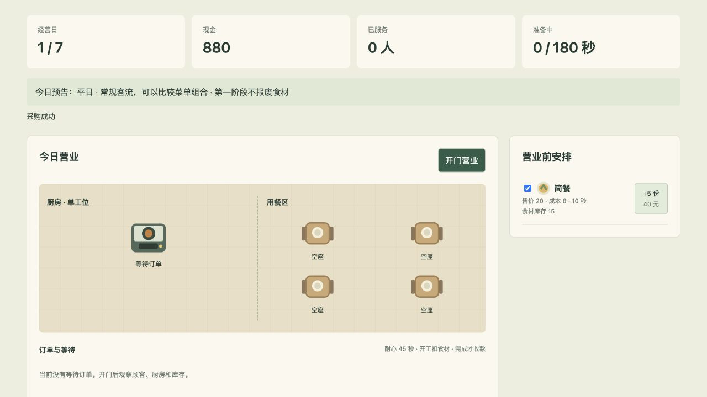
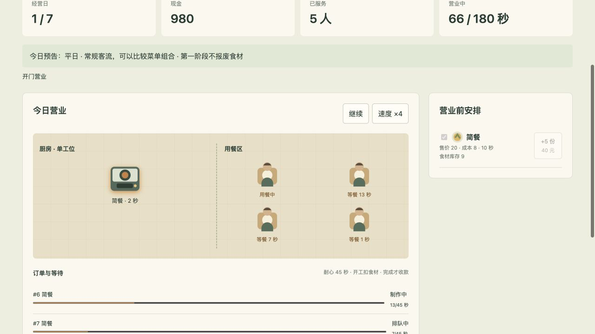
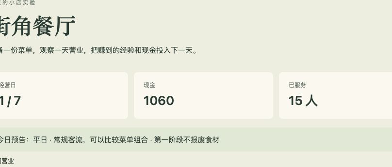

# 第四章 一步步请 AI 做出第一天营业

这章从一句具体要求开始，做到餐厅能开门、接单、做餐、收钱和打烊。你不用自己拼代码。每次把下一件事交给 AI，收到预览后玩一遍，再继续。

先打开[简餐版本](../examples/restaurant/index.html?stage=1)，看看我们准备做到的大小。它只有一种菜，能让你看清每一步。后面再加菜单、设备和更多变化。

## 第一轮，只做采购

告诉 AI：“现金一千，食材零份，一次花四十元买五份。”让它做出一个能点的页面，并启动预览。

第一次检查很简单：点三次，现金应该是八百八十，食材十五份。接着请 AI 帮你准备一个只有三十九元的测试情况，再点一次。应该买不了，而且原来的数字不变。

这是配套案例采购三次后的样子，已经带上了后面会讲的美术。你让 AI 做的第一版可以只有数字和按钮；先对上现金与库存，不必照着这张图一次做齐。

如果这些不对，就停在采购这里，让它继续修。餐厅还很小时，问题容易看见，也不用担心修这里又影响员工和升级。

画面只需标题、数字和按钮。你暂时不必决定店铺装修，功能做通后还能换样子。

## 第二轮，加一份会做完的餐

采购能用了，再说：

> 在现在这个页面上加一个“制作简餐”按钮。有食材才能开始，开始时扣一份，十秒后完成，收入二十元。
>
> 制作过程中显示剩余时间，不能重复点出很多份。完成以后告诉我这单赚了多少钱，保留已经做好的采购功能。
>
> 请自己检查后给我预览。

你可以先不买食材就点制作，看看是否说明“食材不足”。买好以后再点，看看是否先减一份，十秒以后才加钱。

制作中多点几次，观察会不会突然收入许多笔。若会，把这个操作告诉 AI：“我在制作时连点了五次，最后收了多笔钱，希望这一炉只做一份。”它负责查代码，你负责说明这次实际发生了什么。

## 第三轮，让顾客自己来点单

现在不用玩家亲自点制作了。我们要让顾客进店，厨房按先后顺序做他们的餐。

可以这样说：

> 请把手动制作改成顾客点单。先只有简餐、一个厨房工位和四个座位。
>
> 顾客进来后占一个座位，厨房按下单顺序制作，完成后收二十元。用餐十秒后顾客离开，座位空出来。
>
> 请把正在做和正在等的订单显示出来，让我看得懂谁在等谁。先用固定的到店顺序，方便我检查。

这里有几处不必由读者先懂实现，但需要你决定行为：顾客有没有座位才能进？厨房先做谁的？吃完以后座位何时空？上面的要求已经给了一个简单答案，你也可以让 AI 给两种方案比较。

收到预览后，盯着一位顾客看：进店，占座，下单，等餐，吃完，离开。画面若跳过了一步，问 AI 是规则作了简化，还是显示没接上。

这张图暂停在第六十六个游戏内秒。厨房还要两秒做完当前简餐，三位顾客分别等了十三秒、七秒和一秒。你不用读代码，也能据此问 AI：“这位已经等十三秒了，为什么还没轮到他？”

## 第四轮，加上等不及的顾客

没有耐心限制时，厨房再慢也可能把所有订单做完，玩家不容易感到安排有什么影响。我们给等餐一个时间。

> 顾客从等餐开始，最多等四十五秒，制作也算在里面。超时就离开，不付这单的钱；已经用掉的食材算损失。
>
> 请显示等待进度，离开时说明是“等餐超时”。这一单取消以后，厨房应能继续做下一单。

看一轮高峰，找出一位超时离开的顾客。确认他没有付款，之后厨房还在继续。若餐做完了却又出现同一单收入，就让 AI 检查取消后的订单是否还在处理。

这些选择会影响游戏感觉。四十五秒太紧，可以请 AI 调成六十秒，给你两个预览比较。你可以凭实际游玩判断哪种更合适，不需要先会算排队公式。

## 第五轮，让一天有个结束

现在请 AI 加营业时间和打烊：

> 一次营业接新顾客持续一百八十个游戏内秒。时间到就不接新客，已经进来的顾客继续处理，直到离开或取消。
>
> 然后扣一百二十元固定费用，显示日报。日报写收入、用掉的食材、利润，以及没接待上的人数和原因。
>
> 加一个进入下一天的按钮。打开日报本身不能重复扣费。

一百八十个游戏内秒是一段较短的营业，方便反复试。以后想让一天更长，可以再改。当前先不计算加班费，让 AI 沿用这个简化。

打烊以后，记下现金，关闭或重新查看日报。数字不应继续减少。进入下一天以后，今天的订单清空，但剩余现金和食材仍然留着。

这一轮做完，你已经可以说“我做出了一个能玩的小餐厅”，也能开始判断它是否值得继续做。

这轮一共卖了十五份简餐，采购的食材全部用完。账本还记下了六人因缺货没吃到、六人因座位不足没进来。它们给下一轮提供了两个具体问题：多备一点食材有没有用？厨房还忙得过来吗？这里展示的是这一次运行的结果，不是所有菜单都能达到的成绩。

## 让 AI 把难懂的结果讲清楚

日报如果只有几项数字，新手可能不知道明天该改什么。试着提出这样的修改：

> 我看得见今天收入三百元，但不知道为什么有些顾客没吃到。请把缺食材、等餐超时和座位不足分别列出来，并让我在营业时也能找到这些情况。

它可以加文字、图标或简单进度。你要看的是，这些信息有没有帮你理解。如果它只加了一段“经营效率需要提升”，仍然没有回答问题，就把具体疑问再说一遍。

暂时无需把所有统计都做出来。先能解释一轮生意，后面的菜单和升级才有依据。

## 加暂停和加速，让试玩轻松一点

营业时看不清，可以请 AI 加暂停。暂停以后，制作、顾客等待和营业时间都应该一起停。等几秒再继续，看看有没有顾客在暂停中离开。

反复等待也会累。让它加四倍速，但保持规则关系不变：简餐仍花十个游戏内秒，耐心仍是四十五个游戏内秒。只是整段过程走得更快。

告诉 AI：“请检查不同速度下，同一组顾客是否得到相同的结算。”时间怎样计算由它处理。你可以分别试玩，观察是否有某档速度明显多收或漏收。

离开标签页时，当前案例会自动暂停。回到页面再继续，避免人离开一会儿就错过整天。如果你想做离线经营，那是以后要另行设计的一项功能。

## 第六轮，再放进一道慢菜

现在让 AI 加套餐，售价四十五、成本二十、制作三十秒。菜单可以选是否上架。先沿用第二章的数值，不必自己从零想。

这一轮关心的是：套餐做得慢，会不会拖长厨房队伍？它一单留下的钱多，是否值得这段等待？

> 给当前餐厅加招牌套餐，参数沿用我们已经决定的数值。开门前可以选择只卖简餐，或同时卖套餐。
>
> 请准备一组相同的到店记录，方便比较两种菜单。先保持画面和其他规则不变。

你可以让 AI 给出两轮结果，也要自己看看过程。数字变好，不一定意味着游玩更有意思；如果它忙着算最佳答案，却不给你操作和观察的机会，就还需要把比较做成可玩的版本。

## 你可以拿什么来判断这一版

先问自己：这次营业以后，我是否想改点什么？例如少买食材、换一道菜，或者快点攒钱买炉灶。如果这些打算来自刚才看到的问题，经营已经开始有意思了。

如果只是等结束，看看是不是一天太长、安排太少，或者结果看不懂。可以把感受直接告诉 AI：“我开门以后两分钟都没事做，给我两个小改法，尽量保留现有玩法。”让它提具体变化，再挑一个试。

若每次都像碰运气，就让它说明随机来自哪里，是否有提前提醒。不要急着把所有随机都删掉；先看看玩家能否有所准备。

## 让没参与制作的人玩一次

把预览交给一个愿意试的朋友，请他经营一天。你先不替他点按钮，看看他在哪里停住。

如果他问“怎么买食材”，说明开场还不够清楚；如果他问“怎么又亏了”，看看日报有没有回答；如果他已经想试另一道菜，那就是值得记下的反应。

记录他的原话和操作，再交给 AI 修改。别只说“朋友觉得不好玩”，说清他在哪一步、看到了什么、原本期待什么。一次修改解决一件事，比较起来更容易。

## 保存这一版，再做画面

请 AI 保存当前能营业的版本，并写一段怎么打开的说明。之后换美术或加功能出错，就有一个能退回的地方。

原型可以很朴素。它最重要的结果是：你已经玩过自己要做的东西，知道哪里有趣，哪里不顺。下一章再给它选一套画面和声音，不必凭空想象一张漂亮的餐厅图。
