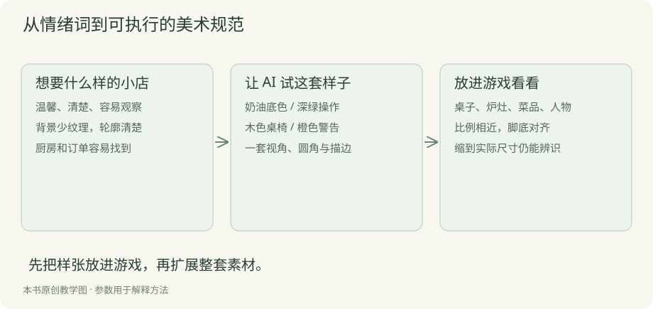
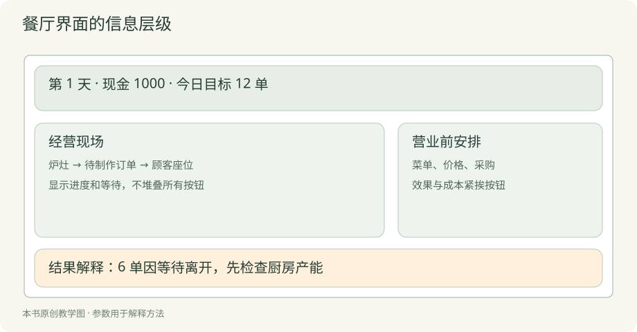
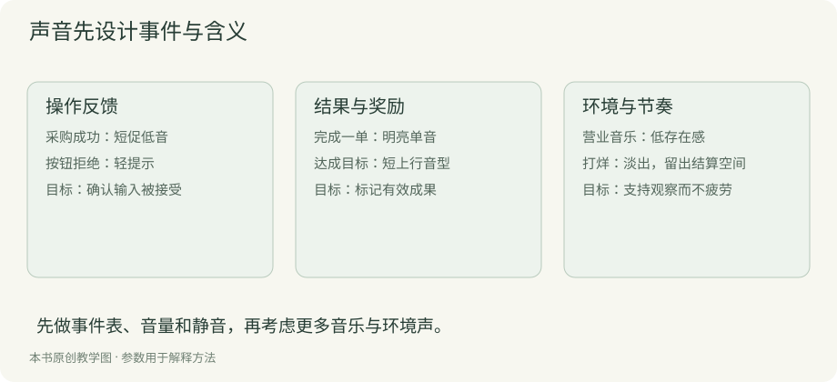

# 第五章 美术与音频素材制作

素材制作的目标是建立统一、清楚、能在目标设备上运行的视觉与声音表达。AI 可以快速生成许多候选图，但生成结果进入游戏之前，还需要规格、筛选、修整和验收。数量本身不会带来一致性。

## 先制定一页风格规范

案例选择俯视 2D、暖色、简洁轮廓。地面弱化细节，可交互设备轮廓清楚，菜品使用容易区分的色块。重要状态不能只依赖颜色，同时使用形状、图标与文字。

规范至少包含视角、光照、轮廓、颜色、尺寸和信息层级。先做一张包含顾客、桌子、炉灶和菜单图标的样张，把它们放在一起观察。单张图片好看，不能保证组合后协调。

不要把“温馨”“精致”当成完整要求。把它们转成可检查内容：降低背景对比，限制主色数量，使用圆角家具，避免复杂金属反光。具体风格由项目决定，关键是每次生成都能引用同一套约束。

## 建立素材清单与预算

按实际屏幕和状态列清单。桌子需要空闲、占用和待清理反馈；炉灶需要闲置、工作和故障反馈。反馈不一定都靠独立图片，也可以通过叠加图标与动画完成。

| 素材 | 首版数量 | 技术约定 | 验收重点 |
| --- | --- | --- | --- |
| 桌椅与设备 | 各少量 | 统一网格与底部锚点 | 比例与占地一致 |
| 人物 | 两种基础形象 | 统一方向与动画帧尺寸 | 远看能分辨角色 |
| 菜品图标 | 三个 | 相同画布与留白 | 缩小后仍能区分 |
| 界面元素 | 一套 | 状态与边距统一 | 按钮反馈清楚 |
| 音效 | 数个关键动作 | 统一响度与格式 | 不刺耳、不遮盖重要提示 |

人物方向越多，动画动作越多，制作和检查成本越高。首版可以使用静态朝向加简单位移，先让经营表达成立。不要在明确需求前生成几十张人物立绘。

## 分批生成，先批准样张

用参考样张固定角色比例、轮廓和颜色，再按类别生成变体。一次生成一整张复杂精灵表，容易出现格子漂移、角色变形和物品数量不一致。可以先生成单个资产，人工确认后再扩展。

```text
用途：俯视 2D 餐厅游戏中的炉灶道具。
沿用参考样张的暖色、简化轮廓、左上方柔和光照。
只生成一个独立炉灶，透明背景，不含文字、地面和其他道具。
预留统一留白，底部中心作为放置锚点。
资产将缩小用于游戏，请保持大轮廓清楚，减少细碎纹理。
```

生成工具应支持透明输出时直接要求透明；不支持时需要抠图。不要把棋盘格误当作透明背景。检查实际 Alpha 通道，并在深浅背景上查看边缘。

把提示词、参考图、工具、日期和生成批次写入素材记录。它帮助复现风格，也便于后续追踪来源。并非所有生成工具都给出可复现随机种子，记录实际可获得的信息即可。

## 将图片修整成游戏资源

导入前统一画布、尺寸、透明边缘、锚点和命名。图片内容不能每张都自动裁到紧边，否则角色切换动作时容易跳动。动画帧使用固定画布，并检查脚底是否保持稳定。

像素风需要使用合适的缩放方式并固定像素尺寸；非像素风也要在真实显示大小检查。菜单图标在大图中清晰，缩到几十像素可能混成一团。先在实际界面查看，再决定是否继续增加细节。

设备的图像尺寸和游戏占地分开定义。一个炉灶可占一格，烟囱和阴影可以延伸到邻格，但不能让玩家误以为阻挡区域更大。放置预览应同时显示可占用范围和是否可达。

资源命名可以采用 `equipment_stove_idle.png`、`food_rice_icon.png`。维护一份清单，将标识映射到文件路径、尺寸、锚点与许可记录。代码引用标识，避免在多个界面散落硬编码路径。

## 用少量动画表达状态

优先制作能解释经营过程的动作：设备工作时的轻微运动、订单完成时的提示、缺货时的标记、收款时的反馈。装饰性动画保持低频，避免影响观察队列。

人物移动需要与规则状态协调。规则已经交付，而服务员还站在厨房，会让玩家误解实际流程。可以让规则触发状态事件，由表现层根据事件播放动画，并明确何时视为交付完成。

别让音效成为唯一信息渠道。关闭声音时，订单、取消和破产仍应通过画面解释。减少动画选项也应保留必要的状态变化。

## 音乐与音效建立层级

先做点击、开始营业、制作完成、重要警告和结算音效，再考虑环境声与背景音乐。普通操作音应短而轻，重要警告更明确，但避免每个失败订单都触发强烈警报。

浏览器可能限制未交互前自动播放音频，因此把音频初始化放在明确的开始操作之后。提供音乐与音效音量设置，保存偏好。不要用每帧新建音频对象的方式播放循环声音。

AI 生成音乐同样需要检查循环接缝、响度、噪声、长度与使用条件。涉及外部素材、字体和音频时，分别记录作者、来源、许可与署名要求；公开源代码不自动意味着你可以公开所有第三方素材。

## 与 AI 协作完成技术处理

让编程助手处理可检查的重复任务，例如验证尺寸、列出缺失文件、生成图集清单、检测引用路径。首次运行批处理前先对几个样本试用，并保留原始素材。

```text
请编写资源检查脚本，只读取 assets/，不要覆盖原文件。
检查清单中的文件是否存在、尺寸是否符合规格、命名是否重复。
报告缺失项与不符合项，并以非零退出码表示失败。
图片是否美观、动作是否自然由人工验收，不自动判定通过。
```

这个边界能避免 AI 把“格式正确”写成“美术质量合格”。修订版附带原创矢量图标和合成音，位图生成、背景音乐与更复杂动画仍需按清单自行制作和验证。

## 美术设计到底要决定什么

美术设计首先决定玩家怎样看懂游戏、感受到什么气氛，以及什么值得注意。选择可爱画风只是起点。你还要决定视角、形体、比例、配色、材质、界面层级、动效和资产规格。每个决定都影响开发和玩家理解。

对零基础读者，可以直接采用本案例的默认方向：俯视近似平面，不画复杂透视；圆角家具、大轮廓人物；奶油纸色背景、木色地面、深绿操作、橙色提醒；低密度纹理；文字保持高对比。先使用这套方案做出一屏，再根据目标体验调整。



这是一组可执行约束。它不要求你能画写实餐厅，却能让你检查 AI 给出的东西是否属于同一套游戏。若某张炉灶是强透视金属照片，即使好看，也不符合当前方向。

## 第一步先画信息草图

打开纸笔、演示文稿或任意矩形工具，画四块区域：顶部经营状态，中间餐厅现场，旁边准备面板，底部结果说明。每块只写需要出现的信息。先判断玩家第一眼看哪里，再决定装饰。



顶部只放当前日、现金、服务人数与阶段；餐厅现场突出厨房和座位；准备面板放菜单、采购和设备；日报解释流失。新手暂时不要把十种货币和全部统计塞进顶部。

把草图交给 AI，要求只用 HTML 与 CSS 实现框架。检查桌面与窄屏下的阅读顺序。确认操作够清楚后再换正式素材，避免花数小时做出的插画遮挡了关键按钮。

## 第二步建立最小风格板

风格板不用复杂，放五种颜色、两种字号层级、一种按钮、一个人物、一个炉灶和一张桌子。你可以直接查看案例的 `style.css` 与 `assets.svg`，先借用，再逐项替换。

| 项目 | 默认设计 | 为什么这样选 | 检查方法 |
| --- | --- | --- | --- |
| 背景 | 浅奶油色 | 给设备与文字让出对比 | 看十秒是否费力 |
| 操作 | 深绿色 | 与环境区分 | 第一眼能找到开门 |
| 警告 | 橙色并配文字 | 有提醒但不过度惊吓 | 去掉颜色仍能理解 |
| 家具 | 木色大块面 | 降低细碎噪声 | 缩到手机仍能识别 |
| 人物 | 头部圆形、身体简化 | 减少制作门槛 | 角色不与桌面混淆 |

颜色之间的关系比单个色号更重要。先在真实屏幕看，必要时使用对比检查工具。不要为了“统一”让文字也变成低对比浅色；可读性高于装饰一致性。

## 第三步列出资产与状态

案例直接附带原创 SVG：简餐、盖饭、套餐、炉灶、桌子和顾客。它们由简单几何形状构成，不依赖外部图片、付费字体或图像生成服务。SVG 用文字描述形状，修改颜色和比例后可以立即在浏览器查看。

这是初学者的一条可完成路径。你也可以用 AI 生成位图，但应保留同样的资产清单和验收方式。判断“是否需要 AI 图片”的依据是表现目标，不必为了使用工具而增加不必要复杂度。

每个素材至少写正常、工作和异常三类表达。炉灶工作可以用亮边与进度文字，异常用图标和原因；桌子空闲时显示桌面，占用时出现顾客；菜品用形状与色块区别。状态可以由代码组合，不必每种状态都生成新图。

## 第四步向 AI 提供可执行画面要求

```text
请为当前街角餐厅制作一屏风格样张，保留现有信息结构。
使用奶油底色、木色家具、深绿主要按钮与橙色提醒。
俯视近似平面，家具圆角、低纹理、轮廓清晰。
先只制作一个炉灶、一张桌子、一位顾客和三个菜品图标。
采用可编辑 SVG，不依赖外部图片或字体。
不同素材画布统一，保留正常与工作状态的显示方案。
先展示组合后的画面，不要直接批量制作几十张资源。
```

如果需要位图，把输出改成独立透明 PNG，并给出目标尺寸。不要把“透明背景”当成写了就已经成功，实际检查边缘和 Alpha。若人物方向不一致，回到样张限制视角，再生成，而不是在代码里硬凑。

## 第五步在游戏里验收

打开[完整教学版](../examples/restaurant/index.html?stage=3)，观察三张菜品图标是否一眼能区分，工作中的炉灶是否突出，订单与用餐区是否争抢注意力。将浏览器缩窄，检查按钮和金额有没有挤在一起。

让 AI 一次只改一个视觉问题，例如让厨房更容易发现、降低地面纹理、增加文字间距。修改后用同一营业情境比较。不要用“更高级”替代问题说明；它可能让模型增加阴影和渐变，反而更难阅读。

若你不会判断，可以先使用五项清单：看得清、认得出、点得到、状态明确、没有互相遮挡。做到这些，再讨论更鲜明的个人风格。

## 音频设计先列声音事件表

音频设计要决定什么时刻发声、声音表达什么、持续多久、谁更重要、怎样避免疲劳。先不用挑一首循环音乐，先把经营事件列出来。



| 事件 | 想表达的含义 | 声音方向 | 同时提供的视觉反馈 |
| --- | --- | --- | --- |
| 采购成功 | 操作已接受 | 轻短低音 | 现金与库存改变 |
| 菜品完成 | 产生有效成果 | 明亮单音 | 收款与订单状态 |
| 每日目标达成 | 值得记住的收获 | 简短上行音型 | 纪念与结果文字 |
| 无法采购 | 条件不足 | 轻提示，可不发声 | 明确失败原因 |
| 暂停或打烊 | 节奏切换 | 淡出或短收束 | 阶段变化与日报 |

表格是设计方案，不能把未实现的声音写成已经存在。当前案例实现采购反馈和完成订单的合成音，默认关闭；纪念声音与背景音乐可以作为后续练习。没有声音时，所有关键规则仍能从画面理解。

## 不会作曲也能完成第一版音效

第一版可以用 Web Audio 合成短音。一个振荡器产生音高，一个增益节点控制响度包络，再连接输出。案例在 `ui.mjs` 中把这段逻辑封装成 `tone`，完成订单时调用一次。

```js
const oscillator = audio.createOscillator();
const gain = audio.createGain();
oscillator.connect(gain);
gain.connect(audio.destination);
oscillator.frequency.value = 740;
gain.gain.setValueAtTime(0.045, audio.currentTime);
gain.gain.exponentialRampToValueAtTime(0.001, audio.currentTime + 0.1);
oscillator.start();
oscillator.stop(audio.currentTime + 0.1);
```

这段代码需要先在玩家操作后创建并恢复 `AudioContext`。不要在页面加载时强行播放；浏览器对自动播放存在限制，遵循[Web Audio 官方实践说明](https://developer.mozilla.org/en-US/docs/Web/API/Web_Audio_API/Best_practices)。用低音量开始，让玩家自己开启。

短音只是建立反馈的可执行起点，不代替完整声音艺术。你可以让 AI 修改音高与时长，再用耳机和扬声器检查，避免刺耳。大量订单同时完成时合并反馈，不能每帧触发声音。

## 背景音乐怎样提出需求

先说明作用：陪伴观察，不抢走经营信息。再给出速度、乐器、情绪、循环与禁用项。例如温和节奏、少量木质打击、柔和键盘、无演唱、避免突然大音量变化。输出时记录来源和使用条件。

检查音乐是否连续循环自然、长时间听是否疲劳、警告音是否能被听见。分别控制音乐与音效，不要用一个总开关让玩家只能全有或全无。当前案例没有背景音乐，你可以按这份需求制作一段，再加入独立音量与暂停逻辑。

## 给不会画画的读者一份可交付任务

下面这张制作单可以直接作为第一轮工作：一张风格板、一屏界面、六个矢量资产、两种设备状态、两种短音和一个静音开关。案例已经提供基础版本，你要做的是选一项替换，并证明它在游戏里可用。

先改桌子颜色，保留占用状态；再改三种菜品轮廓，检查缩小后仍能识别；最后换一套按钮样式，确认禁用、焦点和悬停状态都存在。每次只改一类，不要把所有图标一次替换后再找错误。

资产验收可以按三层进行。文件层检查是否存在、尺寸、透明和命名；组合层检查视角、比例和颜色；游戏层检查是否遮挡、是否传达状态、是否影响操作。只有第一层通过，不能说资产已经完成。

声音也有对应的三层。文件或代码能播放是技术层；音高、响度与时长协调是组合层；玩家能否理解、不疲劳、可关闭是游戏层。音频设计必须在真实事件中听，不能只在播放器里逐个试听。

## 从“看起来不好”到具体修改

如果你觉得画面乱，先遮住装饰，看信息是否仍乱。若乱来自所有文字同样大小，先调整层级；若乱来自纹理，降低背景对比；若乱来自太多状态提示，合并重复信息。先找到来源，再给 AI 明确任务。

如果你觉得声音吵，先降低普通事件频率，而不只是降低总音量。保留重要反馈，合并连续收款，不让同一事件重复触发。若关闭声音后游戏无法理解，补上视觉表达。

风格并非一次生成就固定。你可以在完成小样张后选择另一方向，但重做前先列出受影响的资产和界面。让审美判断与制作预算连接起来，是美术设计中的重要能力。

## 最后动手验证

制作一张场景样张，导入至少一个人物、一个设备和三个图标。分别在正常尺寸、窄屏和深浅背景中观察。检查透明边缘、角色比例、图标辨识、状态表达和资源来源。

样张达到统一标准后再批量扩展。后续若改变风格，先估算需要重做哪些资源，避免局部更新让整个游戏失去一致性。
