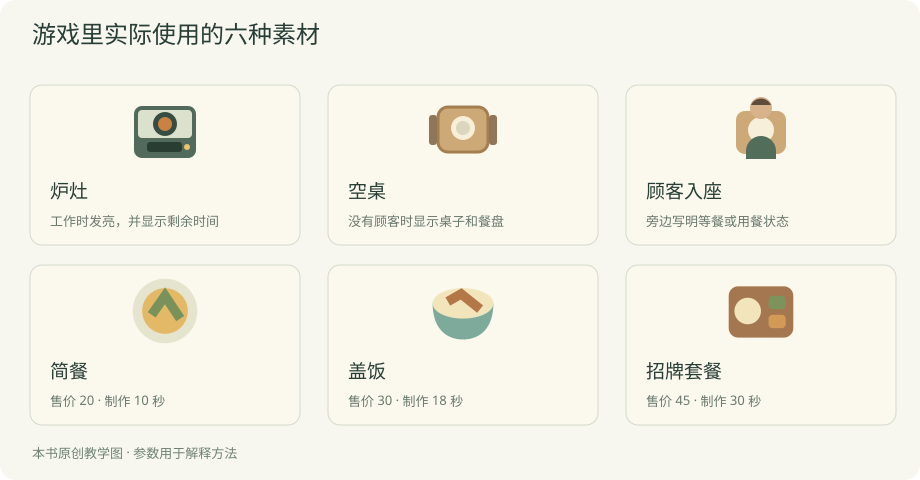

# 第五章 给餐厅画面和声音

现在餐厅能营业了，但看上去可能还像几块表格：厨房是一行字，顾客是一串数字。我们要让它更像一家店，同时让人一眼看出哪里在做餐、哪里有人等。

这一章让 AI 给你页面、画面和声音的方案，你看过、听过以后再选。尺寸、透明背景和对齐等处理，也可以交给它。你可以沿用案例的样子，或者请它做另一套，不需要自己画图。

## 先摆清楚，再考虑画得多漂亮

先告诉 AI 页面上最重要的几件事：我想看今天的钱和营业情况，能在旁边采购，打烊后知道为什么有顾客离开。让它据此摆一版给你看。

你可以给一个简单方向：顶部放日期、现金和营业状态；中间放厨房与座位；旁边放菜单和采购；日报放在营业现场下面。实际怎样排，由它实现。


先用方块和文字也行。看预览时，试着完成一次采购和开门。按钮藏得太深，就直接说“我找不到开门，把它放到营业状态旁边”。这已经是足够清楚的反馈。

让 AI 同时给出手机上的样子。你不必设计另一套页面，只需告诉它，窄屏也要看清金额、点得到按钮，重要操作不要被一大张场景挤到很下面。

## 选一套你能持续做下去的样子

街角餐厅用了比较简单的办法：浅色背景，木色家具，深绿按钮，橙色提醒。人物和设备都用圆角、大块面，地面只留很淡的格子。

你可以直接从这些颜色起步：

| 用在哪里 | 案例里的颜色 | 想让它起什么作用 |
| --- | --- | --- |
| 页面背景 | `#edeede` | 比白纸柔和，放在后面 |
| 面板 | `#fbf8ee` | 让菜单和账本容易分开 |
| 正文 | `#263d34` | 在浅底上看得清 |
| 主要按钮 | `#315d49` | 容易找到开门、进入下一天 |
| 普通说明 | `#69786c` | 比正文轻，但仍能读 |
| 提醒 | 木橙色一类 | 和环境分开，旁边同时写原因 |

这些颜色已经用在案例里。你可以直接让 AI 沿用，也可以说想更明亮或更沉稳，让它做两版预览比较。若把所有文字都改成很浅的灰色，画面可能显得轻，却读起来费劲。

风格统一也体现在形状上。桌子都用圆角，炉灶也可以用圆角；人物轮廓简单，道具就别突然布满真实金属反光。把几张图摆到同一屏里比较，比单独挑“最好看的一张”更可靠。


## 第一批只做眼前用得到的图

先列六种：炉灶、桌子、顾客、简餐、盖饭和套餐。它们足够装进已经能运行的页面。



这些图直接取自游戏里的素材文件。上排帮助你分清设备与座位，下排用不同轮廓区分菜品。三道菜缩到菜单里只占一小块，所以先看能不能认出差别，再考虑添细节。

设备和人物需要多想一步：工作时与闲着时有什么区别？不一定每种都画两张。炉灶工作时可以亮一点，并显示还剩几秒；桌子被占用时放上顾客；缺货则在菜品旁写明“食材不足”。

这比一开始生成几十张人物头像更贴近当前需要。后来若加员工、清洁或新设备，再按新功能补图。每张图都要在页面里有明确用途。

| 图 | 第一次做多大 | 需要注意什么 |
| --- | --- | --- |
| 炉灶 | 约 80×76 | 和桌子比例协调，工作时能看出来 |
| 桌子 | 约 80×76 | 空座与占用要容易区分 |
| 顾客 | 与座位相近 | 不和桌面混成一块 |
| 菜品图标 | 40×40 的画布 | 缩到菜单上仍分得出三种菜 |

表里的尺寸沿用案例。你换成别的风格也可以，但同类图尽量用相同画布。这样换图、排版和做动画时都轻松一些。

## 不会画画，可以先用 SVG

案例用简单图形画桌子、炉灶、人物和菜品，放在 `assets.svg` 里。这类图可以放大，颜色与比例也容易调整。制作和修改都可以交给 AI。

可以这样请求：“沿用现在的暖色和圆角，画一张桌子、一个炉灶、一位顾客、三个菜品图标，先放到同一屏里给我看。素材采用可编辑的 SVG，不依赖外部图片。”

你只需要比较组合后的样子。炉灶是不是太写实，人物是不是比桌子大许多，三种菜缩小后还能不能分清？指出具体一处，要求它调整。

SVG 是这一版采用的办法。若你更喜欢手绘或像素画，也可以让 AI 按那个方向准备样张。先确定一屏的效果，再继续做整套。

## 第一次改图，改哪一处

先挑最影响你观看的一处，例如桌子太深、顾客像一块盘子，或者简餐和盖饭分不清。给 AI 截图，并圈出或描述位置。

可以说：“桌子的颜色比人物还醒目，浅一点；其他部分先不变。”也可以说：“菜单里的简餐和盖饭太像，请换一种明显不同的轮廓，不要只换颜色。”

它修改以后，重新开一轮营业。看看图在实际菜单和座位中是否合适。单独看漂亮的小图，放到文字、按钮旁边可能仍然挤，所以要在游戏里判断。

让 AI 保留原素材，选定新版本后再替换。一次只换一类图，你比较起来也容易。

## 想用 AI 生成图片，怎样提要求

先决定视角。俯视接近平面的炉灶，和正面带强透视的炉灶，放在一起很难协调。再决定轮廓、颜色、光照和背景。给生成工具一张已经选定的参考，比每次只说“温馨可爱”更容易保持相近。

第一次只生成一个炉灶，可以这样说：

```text
给一款俯视 2D 餐厅游戏画一个独立炉灶。
请参考附图的木色、深绿、圆角和简洁轮廓。
光从左上来，少画细碎纹理，缩小后也要认得出来。
透明背景，不带地板、人物、文字或其他设备。
先只做这一个，不做整张餐厅场景。
```

拿到结果以后，请 AI 放到桌子旁边作比较。大小是否相近？看上去是不是同一个角度？阴影方向一致吗？如果不对，先改这张，等样子合适再继续做别的设备。

一次生成整套精灵图，常会遇到每格大小不一、人物长相变化、动作缺帧等问题。第一版可以先用静态人物加简单位移，把长动画留到后面。你要维护的图片越少，越容易完成。

## 透明背景和边缘怎样检查

有的生成图带着棋盘格，看上去像透明，实际上棋盘也被画进了图片。让 AI 把它放在浅底、深底各做一张预览，就容易发现。

边缘还可能有一圈白色，放在深色地面上尤其明显。让 AI 抠图或重新导出透明 PNG，随后再看预览。边缘清楚以后，再缩到游戏里实际大小。

不要为每张人物都裁出刚好贴边的画布。人物有时抬手、有时放下，裁得不一样，切图时身体就会跳来跳去。保留同样大小的画布，让脚底留在相同位置。

这里说的对齐点，常叫“锚点”。你可以想象把一枚图钉钉在人物脚底，所有动作都按这枚图钉放回场景。桌椅则可以选底部中间或格子中心，只要同类保持一致。

## 让动画说明正在发生什么

厨房工作时轻微发亮，完成时出现餐品；顾客等待时有进度条，用餐时换一个姿态。这些变化帮助玩家读懂经营。

装饰动画可以少一些。每张桌子都晃、每次收入都飞满屏金币，重要的订单很容易被淹没。先让缺货和超时看得见，再考虑更多热闹。

动画与收款也要对上。若餐还在厨房，界面已经收钱，玩家可能误以为程序有错。当前案例把做好和交餐合并，完成时立刻收款。如果以后加送餐员，就让交到顾客那一步负责收钱。

关闭动画或减少动态效果时，文字和图标仍要能表达状态。你可以让移动变简单，但“正在做”“已取消”不能跟着消失。

## 不知道画面哪里不对，可以分开看

让 AI 给一个暂时隐藏装饰的预览，只看文字和按钮。是否一眼能找到当前操作？若找不到，把你想找的内容告诉它，请它调整位置或大小。

然后看环境。地板纹理是不是比订单还醒目？厨房与桌子是不是颜色太接近？降低背景细节，往往比继续增加图案有效。

最后看状态。工作中的设备、满座的桌子和不可购买的升级，是否有区别？普通、选中、禁用和键盘焦点都值得看一遍。把“看起来乱”拆成这样几个问题，就容易给 AI 明确的修改。

## 声音先从两件小事开始

开门前采购成功，给一声轻提示；餐做完收钱，再给一声明亮一点的短音。先把这两处做好，就能感觉到操作与成果。

接着再考虑每日目标和打烊。一天结束可以安静一点，让人看账；第一次达到目标可以多停留一下。声音的多少和长短，取决于它想提醒什么。


写成一张小表，就能交给 AI 或音频制作者：

| 什么时候 | 希望玩家听懂什么 | 声音可以怎样做 |
| --- | --- | --- |
| 采购成功 | 按钮生效了 | 短、轻，稍低的音 |
| 订单完成 | 一单生意做成了 | 清楚、稍亮的单音 |
| 达到日目标 | 这件事值得高兴 | 很短的上行音型 |
| 打烊 | 营业结束，可以看账了 | 收束或淡出 |
| 背景 | 陪着看店，不抢注意力 | 平缓，少突然变化 |

当前案例做了前两种短音，默认关闭；目标音乐和背景音乐还没有加入。你可以把后面几行当作自己的练习，不必在第一版一次做齐。

## 不会做音效，也能先试一声

先让 AI 做两种“订单完成”短音供你试听：一种稍亮，一种稍柔和，长度都短一点。听过以后选一个，不需要你知道音高与音量的代码怎样写。

配套案例的短音由浏览器合成。你可以直接让 AI 沿用这套办法，再提出“再轻一点”“拖得太长”“连续完成几单时别一直连响”等反馈。

如果需要更丰富的音色，可以让它准备音效文件并接进游戏。重点仍然是放在真实订单中听。单独试听舒服，连续播放几十次可能就吵了。

先按玩家的点击开启声音，并提供关闭入口。浏览器对自动播放有限制，具体实现可以让 AI 按[Web Audio 官方说明](https://developer.mozilla.org/en-US/docs/Web/API/Web_Audio_API/Best_practices)处理。

完成订单是一次事情，画面却会不断刷新。若没有新订单也一直响，描述这个现象，让 AI 查触发位置。你负责听见并指出不对，它负责找到代码里的原因。

## 背景音乐怎么选

先说清它在什么时候播放。我们的餐厅主要让人观察与安排，音乐可以平缓、没有人声，给订单短音留出空间。玩家看账时，音量可以降低，或者暂时停下。

让 AI 生成音乐时，描述速度、乐器、气氛、循环和不想要的变化。例如：“轻柔键盘配少量木质打击，节奏平稳，无演唱，可以循环，避免突然加大音量。”

听一遍开头和结尾怎样相接，再连续循环几次。开头很好听，不代表反复听不累。还要在真实订单和提示音中听，确认两者不会互相盖住。

加入音乐后，给音乐、音效分别留控制。有人想关音乐但保留收款声。所有重要信息也应能从画面看见，让静音的玩家仍然能玩。

## 保存来源，方便以后发布

下载的图、字体和音乐，各留一条来源及使用要求。需要署名的，记下署名；自己生成的，留工具、日期、参考和提示词。等到上线时再找，会比现在麻烦。

案例自带的 SVG 和合成音代码跟随仓库 MIT 许可。若换了外部素材，就按新素材的要求处理。公开代码并不会替你取得每一张图片的使用许可。

这一章结束时，不用追求整套素材都精致。先让一屏餐厅的颜色、比例和状态协调，让采购和收款有轻重合适的声音。下一章再把设备、存档和七天流程接完整。
