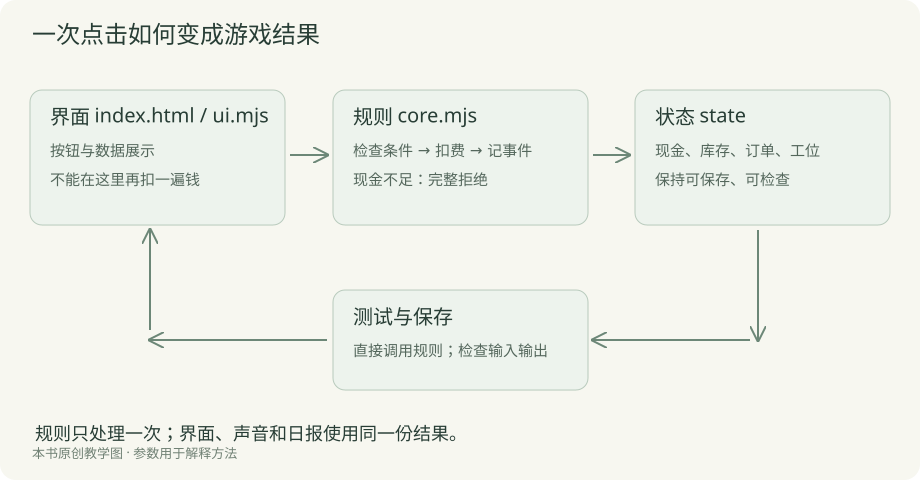
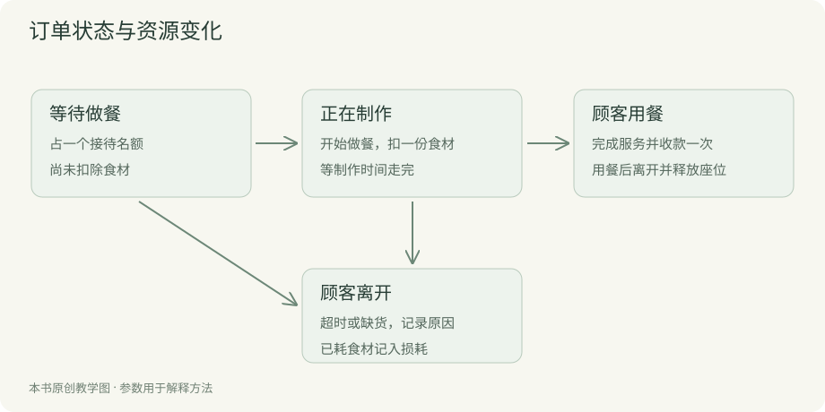

# 第六章 让 AI 把小店做完整

前面的餐厅已经能营业一天。接下来要让玩家有更多事情可想，也能连续玩下去：选菜单、定价格、看客流、攒钱买设备，退出以后还能接着玩。

你仍然从想要的效果出发。每一轮都给 AI 一个清楚的要求，让它做好、启动预览，你再试玩。代码放在哪、怎样连接已有功能，由它处理。

## 先告诉 AI，这一版准备做到哪里

把前面已经作出的决定放在一段话里：一家店，三道菜，固定桌椅，营业前准备，营业中观察，打烊看账，一共经营七天。

再告诉它暂时不加哪些事。比如外卖、员工性格和自由装修都先放下。这不是要求你先懂技术，而是防止它每做一项功能又顺手扩出很多事情。

> 在已经能营业的版本上，继续做七天经营。这版要有三道菜、价格选择、客流预告、设备升级和保存。
>
> 桌椅位置先固定，做餐和送餐沿用现在的简化方式。请把工作分成几步，每做完一步都给我可试的预览。
>
> 先告诉我第一步准备做什么，不要一次把所有功能都改完。

看它列出的顺序，确认是否仍然围绕这家小店。你不需要评价代码架构，主要看每一步能带来什么可见变化。

## 把菜单补到三道菜

简餐和套餐已经有了，再加盖饭。售价三十、成本十二、制作十八秒。玩家开门前勾选上架哪些菜，顾客只从这份菜单点。

请 AI 同时做好采购入口、库存显示、订单里的菜名和完成后的收入。你可以直接说：“我要能看到盖饭的全部过程，不只是菜单上多一行字。”

检查时，只上架盖饭，买几份，开始营业。看看来的人点的是不是盖饭，制作是否比简餐久，做完是否收到三十元。然后换回混合菜单，看看三种菜能否同时正常出现。

如果勾掉了全部菜，开门应该给出提醒。已有订单也应保留接单时的菜品和价格，不能因为以后改菜单而突然变了。当前版本只在营业前改菜单，这样比较容易理解。

## 把定价交给玩家

三个价格档位就足够让人开始比较。亲民价格低些，容易卖；精品价格高些，会有更多人看价后离开。

你不用自己给每类顾客编公式。可以先让 AI 提供一个简单方案，要求它用例子解释：“原价一百个潜在顾客大约多少人愿意买，涨价以后大约怎样？”确认大致关系后再做。

> 加亲民、原价、精品三档售价，开门前选择。每档直接显示三道菜实际卖多少钱。
>
> 精品每单赚得多，但会有一些顾客嫌贵离开；亲民则更容易卖。请给一个简单、可调整的做法，并在日报单列因价格离开的人数。
>
> 我先看得懂和玩得通，暂时不用复杂的市场模型。

做完以后试一次精品价。看顾客减少是否能被发现，也看收入有没有对应变化。若只是售价数字改了，顾客毫无反应，就让 AI 检查价格是否真的影响选择。

你也可以决定做更轻松的游戏，价格不想频繁调整。那就减少档位，或把它作为开店定位，而不是每天必做的操作。先说你想让玩家忙在哪里，再让 AI 提做法。

## 让明天有一点变化

现在玩家可能已经熟悉稳定客流。我们加入三种预告：雨天较冷清，平日普通，街区活动较忙。

请 AI 在开门前显示预告，再让实际到店带一点变化。不要只显示天气图标，却没有改变生意；也不要没有任何预告就突然罚钱。

> 每天开始时，显示雨天、平日或街区活动中的一种。雨天顾客少，活动日顾客多，具体到店时间仍有变化。
>
> 预告在采购前就能看到，让玩家能据此决定备多少食材。请保留一种重现同一局的办法，方便你检查问题。

它可能提到随机种子，你可以理解成重放用的号码。怎么生成由它处理。你只需能说“再给我刚才那一局，换个菜单试试”。

试玩时，问自己预告有没有影响准备。若不管雨天还是活动日都照着同样数量买，可能变化太小，也可能库存和产能没有形成压力。把这个感受交给 AI，让它提小幅调整，而不是马上增加更多事件。

## 让食材剩多了也值得在意

没有损耗时，玩家可能一次买许多，之后几天不再考虑采购。我们给剩余食材加一点损耗，让“多买一点”有代价。

可以沿用案例的简单做法：打烊时，剩余每种食材损耗百分之二十，份数向下取整。剩五份坏一份，剩四份不坏。旁边说明规则，日报列损失。

让 AI 按这组例子检查。你不需要自己检查取整代码，只要看看剩五份那天，第二天是否确实剩四份。采购的钱已经付过，报废时不该再扣一次相同现金。

如果想做得更细，可以让 AI 给你两种保鲜方案比较：统一按比例损耗，或按批次记录保质期。后者需要更多显示和操作，第一版不一定值得加。

## 第二个工位，怎样让人盼着买

前面已经遇到排队，这时第二个工位就有了用处。它花三百元，第三天起可买，买完厨房能同时做两份。

你可以这样委托：

> 第三天起开放第二工位，价格三百元，只能买一次。只允许营业前购买，现金不足时写明还差多少。
>
> 买好以后画面能看见两个工位，厨房可以同时做两单。同一个订单不能被两个工位重复做，也不能收两次钱。
>
> 请检查购买、重复购买，以及保存读取以后是否还保留设备。

这里既说了经营效果，也说了你准备看的画面。若只多出一个炉灶图，等餐完全没变，就让 AI 确认是否增加了真实制作能力。

购买之前还要让玩家看见手头现金。设备买完不够采购，是一个可以理解的投资风险。若想保护新手，可以给提醒：“购买后还剩多少，今天固定费用多少。”不必直接禁止所有冒险。

## 让不同升级解决不同问题

第二天开放增加两座，价格二百元；第四天开放高效炉灶，价格四百元，缩短制作时间。先沿用这三项，其他升级以后再说。

让 AI 把效果写在购买按钮附近，别只写“效率提升”。“可同时做两单”和“增加两个座位”，读者和玩家都容易想象。

试玩时看看是否真的需要选择。如果钱很多，总能一路买满，就失去了存钱和安排的过程；如果设备太贵，七天里几乎买不到，前面的期待又会落空。你可以让 AI 根据几轮结果提出价格建议，再自己试玩比较。

不要把每项升级都改成单纯加收入。玩家能看到厨房变了、座位变了，比一个隐藏的百分比更容易感到收获。

## 把日报变成明天的线索

一天结束时，玩家需要知道两件事：今天留下了多少，以及哪里错过了生意。

让 AI 把收入、已售食材、损耗、固定费用和利润分开写；现金变化另列。再把缺货、等餐超时、座位不足和嫌贵分别列人数。

如果画面太密，可以让它给你两种排法。例如一种先显示“赚了多少”，另一种先显示“哪里损失最多”。你选更容易看懂的一种，不必自己先画专业界面。

有一处容易出错：玩家重新打开日报时，游戏不能再扣固定费用。你可以直接让 AI 检查这件事，并在预览里多开几次。如果它只说“报表已优化”，继续问：“我关掉再看，现金会不会变？”

## 给重要的第一次留个记号

让 AI 记录第一单、首次盈利、单日服务十二人。它们是经历的纪念，不另外送钱。

可以在侧边放一个小列表，做到以后点亮，并在打烊时留一句说明。普通订单仍用短音和数字反馈，不必每次都弹庆祝窗口。

你也可以把纪念改成更有题材感的内容，比如第一位回头客或第一次零浪费。先决定你希望玩家记住什么，再让 AI 提出表现方式。若它建议加入一整套成就货币与商店，可以先缩回眼前这几项。

## 七天以后，给这次经营一个结束

教学案例用七天作为一段体验。第七天打烊后，回顾累计服务、已有设备和取得的纪念，再提供重新开始。

请 AI 把结束做成一个可以看清成果的页面，别只是弹“胜利”。玩家应该知道自己经营出了一家什么样的店，也知道重来还能试什么。

若现金变成负数，则给清楚的失败说明，保留这一轮的结果。让玩家知道是设备买早了、食材浪费了，还是一直没有解决排队。下一次才有改法。

以后想改成无限经营，再讨论更长的成长和挑战。当前先保证一个人能够从开场一直走到这段结束。

## 保存以后，关掉还能接着玩

存档涉及不少技术，但需求可以说得很普通：“我今天没玩完，明天打开还能继续。”

第一版先只在开门前和打烊后保存，营业中暂时不存。这样你也容易检查恢复后对不对。

> 加保存和读取功能，先保存在当前浏览器。保存现金、库存、日期、菜单、价格、设备和已经获得的纪念。
>
> 只在营业前或结算后可保存，营业中说明为什么暂时不能存。读取失败时不要覆盖原来的记录，请给能看懂的提示。
>
> 请检查保存后刷新、重新打开，以及旧版本记录的情况。

试玩时，先保存第一天结算，再进入第二天，然后读取。看它是否回到保存时的日期、现金和库存。你不用看存档文件也能检查这些。

本机保存不等于云存档。换电脑、换浏览器或清除站点数据，都可能找不到原记录。把这件事写在保存旁边。等真要跨设备继续时，再单独安排账号和服务。

## 新功能加了，旧存档怎么办

假设后来增加一道汤，旧存档里没有汤的库存。你可以要求 AI：“读取旧记录时，为新菜补零库存，原来的钱、设备和菜品都保留。”

这件事在技术上叫迁移，但你只需检查旧记录读回来是否正确。让 AI 保留一份旧存档作测试，再给你预览。不要为了方便读取，直接把旧玩家进度清空。

改动比较大时，它可能提供几种方案，比如保留旧局、对新局开放，或者将旧局转换。请它用玩家会受到什么影响来解释，你再决定。

## 让画面与声音接到真实经营上

把上一章选好的图交给 AI，要求按实际状态显示：厨房空闲、正在做餐，桌子空闲、顾客等餐或用餐。不要只把一张热闹插画铺在背景上。

声音也按真实事件触发。采购成功响一次，订单完成响一次。画面刷新很多次，不代表声音也要跟着重复。你若听见一声接一声不停，就描述“没有新订单完成，却一直响”，让 AI 检查。

素材替换和规则修改最好分开。一轮只换炉灶图，再跑同样的营业；确认正常以后，再改制作能力。这样你更容易判断这次变化是外观还是玩法。

## 不会安排页面，让 AI 做两个版本

比如日报看起来太乱，你可以提供截图，说：“我最关心今天赚了多少、为什么有人没接待上。请给两种更清楚的排法，沿用已经选好的颜色。”

让它实际做成预览。你比较哪版更容易找到数字、手机上是否需要横着拖。只让它口头描述“采用卡片式布局”，没有实际画面，很难判断。

一旦选定，就让它继续沿用。后续新增功能放到同样的位置和样式里，别每一轮都重新换整个界面。

## 若想加会走路的员工

当前案例把制作和交餐作了简化，还没有独立员工走路。它已经能说明经营关系。若你想增加这层热闹，可以另外开一轮要求。

先只加一个服务员，沿固定路线取餐、送到桌边，不做自由装修。看看动作是否自然、时长是否影响经营。只有角色能顺利完成工作后，再考虑玩家移动桌子。

自由摆放会带来新问题：桌子挡住厨房、入口被封、两个员工互相堵住。让 AI 逐个处理，并把无法到达的原因显示出来。你不需要写寻路算法，但要玩过这些情况，确认餐厅仍然能营业。

如果你想知道 AI 怎样实现，可以让它拿一次采购讲：点的是哪个按钮，哪里检查现金，哪里改变库存，哪里显示结果。这个解释有助于讨论错误，但不要求你以后亲自维护每一行代码。

## 订单出问题时，按一位顾客来讲

假设有顾客坐下以后一直没饭。与其说“员工系统有问题”，不如让 AI 查看这一位：他何时进店，点了什么，订单有没有进入厨房，食材够不够，现在卡在哪里。

这张图也可以交给 AI 作检查。它应该能解释每一步为什么发生，以及某单取消后谁释放了座位和工位。你看的是人和餐有没有按预期继续走，内部代码由它查。

如果加入独立送餐，图上就多一步“待送达”。此时决定钱在做好还是送到时到账，并让画面对应。遇到这些题，先用生活里的过程说清楚，再让 AI 实现。

## 把改动交给 AI 时，留下一句“原来哪些照旧”

新菜、员工或天气都会碰到已经有的功能。你可以在要求后补一句：“原来的采购、结算和存档继续可用，请改完后一起检查。”

它应该运行项目已有的自动测试，也应该实际打开预览试一轮。自动测试主要看规则是否对，预览则看按钮、图和声音有没有接上。你可以请它把测试结果简短列出，不必自己读全部测试代码。

若它因为某项检查失败，建议删除检查，先让它解释那项检查原本在防什么。如果是你有意改了规则，再同步改；如果只是新代码出错，就继续修。

## 这一版完成以后，你应该拿到什么

你应该能直接打开一个地址，从第一天开始，作菜单和采购安排，体验忙日与冷清日，买到设备，保存进度，并走到第七天。每个承诺的功能都能亲手试到。

让 AI 把这一版保存下来，写清启动方法和已知问题。暂时没做的功能从正式按钮里拿掉，免得玩家点到空白入口。

到这里，餐厅已经从一个想法变成可玩的项目。下一章要请更多人来玩，找的既有程序错误，也有“等得太久”“看不懂”“根本没必要选择”这样的问题。
