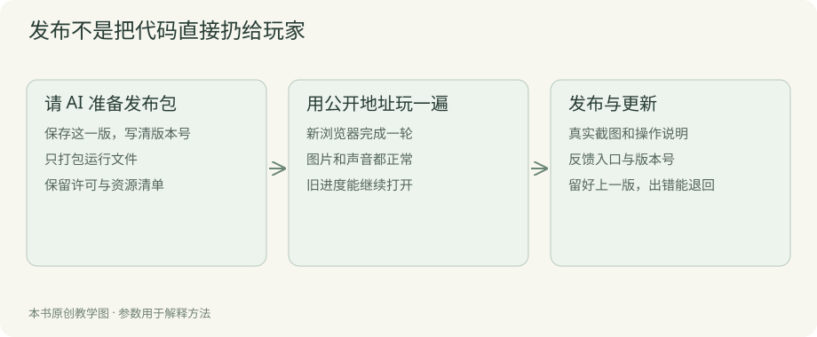

# 第八章 把游戏发给玩家

朋友在你旁边能玩，和他回家打开链接就能玩，还差几件事：把运行需要的文件放齐，准备介绍和截图，上传到合适的地方，再用公开链接检查一遍。

这些工作大部分可以让 AI 完成。你决定叫什么、发到哪个账号、什么时候公开；它准备文件、配置发布，并协助检查。

## 先保存准备公开的这一版

告诉 AI：“把现在能从第一天玩到第七天的版本保存下来，给它一个版本号。接下来只准备发布，先不加玩法。”

版本号帮助你分清玩家遇到的是哪一版，也方便以后修错。比如页面上写着 0.1，收到问题时就能对应到当时的文件。

让 AI 同时保留一份可重新发布的文件。若更新出错，可以退回上一版。涉及存档变化时，还要问旧进度能不能继续，不能只顾着退程序文件。



## 让 AI 准备发布文件

你可以直接这样委托：

```text
请为当前浏览器餐厅准备一个可上传的发布包。
入口是 index.html，把运行需要的图片、样式和代码一起放齐。
排除私人文件、账号信息、依赖缓存和无关素材。
请解压到另一个位置，启动后实际完成一天营业。
告诉我最终应该上传哪个文件，不要让我自己猜发布目录。
```

配套案例运行所需的是页面、样式、界面代码、规则和图标。AI 若改用了打包工具，文件结构可能不同。你不用逐个记，只需让它确认输出可以独立运行。

“构建”这个词指的就是把项目整理成适合发布的文件。已经看见一个干净的输出包，通常比了解它每一步怎样压缩更重要。

## 本机地址不能直接当游戏链接

`127.0.0.1` 或 `localhost` 表示当前这台电脑。把这样的地址发给朋友，他打开的是自己的电脑，并不会自动看到你的餐厅。

所以需要把发布包放到公开服务上，再得到一个别人能访问的地址。GitHub 仓库可以保存源码；是否能直接玩，要看有没有另外配置网页发布。

本书阅读站点用了 GitHub Pages。餐厅游戏则可以用支持浏览器游戏的平台，例如 itch.io。首个项目选一条路走通即可，不必同时准备多个商店。

## 以 itch.io 为例发布浏览器版

[itch.io 的官方说明](https://itch.io/docs/creators/html5)支持上传 HTML5 游戏。多文件游戏通常打成 ZIP，包含入口 `index.html`，资源路径和大小写要正确。

账号登录由你完成。进入创建项目页面后，填写名称和简单介绍，选择浏览器游戏类型，上传 AI 准备好的包，再设置游戏窗口和启动方式。

如果使用的 AI 工具能操作页面，你可以让它协助；若不能，让它根据当前界面逐步告诉你点哪里。一次处理眼前这个页面，不必先给你一长串可能已经变化的按钮名称。

先预览，确认加载、开始、全屏、声音和存档。满意后再公开。实际限制与设置以发布时的官方页面为准。

## 页面第一句话写玩家会做什么

介绍不用堆“沉浸式”“高自由度”。可以先写一句：

> 选菜单、备食材，观察厨房忙起来。每天换一个安排，把街角小店经营七天。

玩家读完大概知道会发生什么。再用几张真实画面展示准备、营业和打烊，补充鼠标操作、暂停加速、本机保存，以及当前有哪些限制。

让 AI 帮你写两三种介绍可以，但要对照实际版本删掉没做的东西。案例没有自由装修，就别把一张概念图上的大餐厅说成玩家能亲手建造。

名称和封面可以表现气氛，截图需要说明游戏。准备一张能看清操作的图、一张忙碌现场、一张结果页，通常比只有漂亮插画更有帮助。

## 截图和短视频也让 AI 协助

请它打开发布版，准备合适的经营情况，截图时别留下报错窗口和临时测试文字。每张图最好说明一件事：菜单选择、排队、升级，或一天的收获。

短视频可以从一轮实际营业中截取：采购，开门，厨房忙碌，第二工位出现，最后看到结果。片段之间有变化，观众才容易明白游戏做什么。

你负责检查画面是不是本版真的能做到。AI 没有办法取得某个场景时，宁可少放一张，也不要用生成图片冒充实机。

## 发布时怎样说明收费

第一次可以先发布免费试玩，收集反馈，再决定后续如何收费。免费不等于不需要完整说明，玩家仍要知道能玩多少、进度怎样保存。

如果准备付费，先检查平台支持的售卖方式和费用，再决定价格。试玩版与正式版分别有什么，要写清楚。让 AI 帮你整理类似作品和定价方案，但别把没有依据的销量估算当成收入计划。

本书主要把发布过程讲通，不承诺一个价格就能卖好。游戏规模、玩家需求、展示和持续修改都会影响结果。

## 公开以后，请别人从链接开始

找一个没有项目文件的朋友，让他从发布页面进入。先别告诉他“点这里再点那里”，看介绍和开场能否让他独立开始。

他能不能加载，第一轮是否看得懂，声音会不会突然很大，退出再来是否还能找到进度？这些都在公开地址上试。

发现问题时，记下链接、版本和设备，交给 AI 修。若只有某台设备打不开，让它检查加载和浏览器错误；若所有人都不懂怎么开门，则回到引导和文案。

## 素材来源在这里再查一遍

让 AI 列出这版使用的图片、字体、音乐及来源。需要署名的放到相应位置，使用条件不清楚的先替换或核实。

案例自带资源与外部换入的素材分开看。你公开了源码，也不自动拥有其他图片和音频的分发权。平时留好来源，此时就不会临时到处寻找。

若发布平台询问 AI 内容，按实际使用填写。AI 帮忙写代码，和游戏交给玩家的生成图片、音频、文字，可以是不同事项。以平台当时的表单与[Steam 内容调查说明](https://partner.steamgames.com/doc/gettingstarted/contentsurvey)等官方资料为准。

## 想上桌面商店，另做一轮准备

浏览器版本发布后，可以再考虑桌面程序和 Steam。需要检查导出、目标系统、启动、安装和存档位置，不只是把网页文件换个名字。

先让 AI 评估现有项目怎么做桌面版，给出需要的工作、费用和必须由你操作的账号步骤。你确认以后再执行。官方入驻与审核流程可以从 [Steamworks](https://partner.steamgames.com/doc/gettingstarted) 查看。

首个版本不用同时承担这条路线。已经有一个别人能打开的链接，就能开始收集真正的游玩反馈。

## 留一个找得到你的地方

发布页放反馈入口，最好让玩家知道怎样提供版本、问题和截图。可以用仓库 Issue、表单或已有社区。只收解决问题所需的信息。

让 AI 帮你写一条简单模板：“在哪个版本，做了什么，预计发生什么，实际发生什么。”玩家愿意补充时，后续修起来会快很多。

最后请 AI 留下这一版的源码记录、发布文件、公开链接和已知问题。接下来要做的，就是根据这些反馈改第一轮，而不是立即堆进更多功能。
